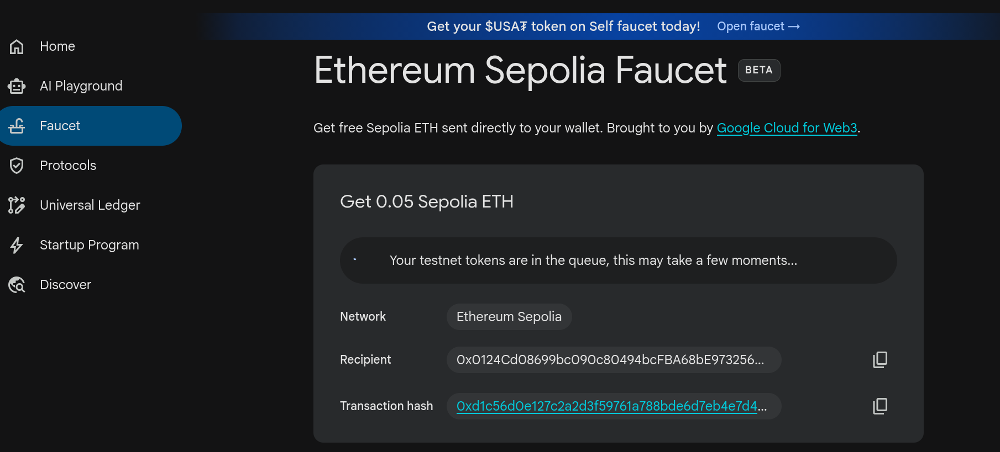
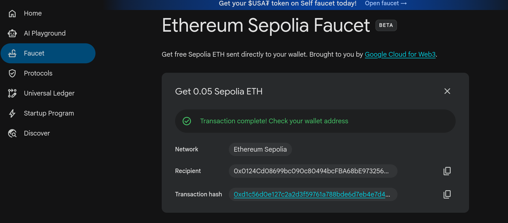
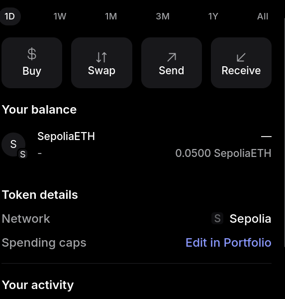
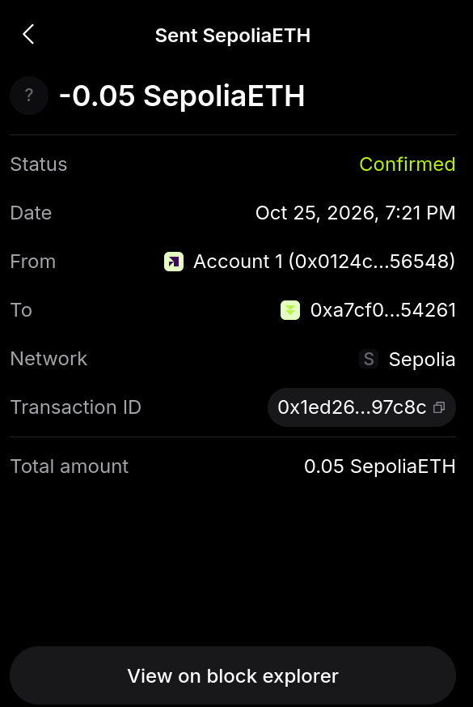
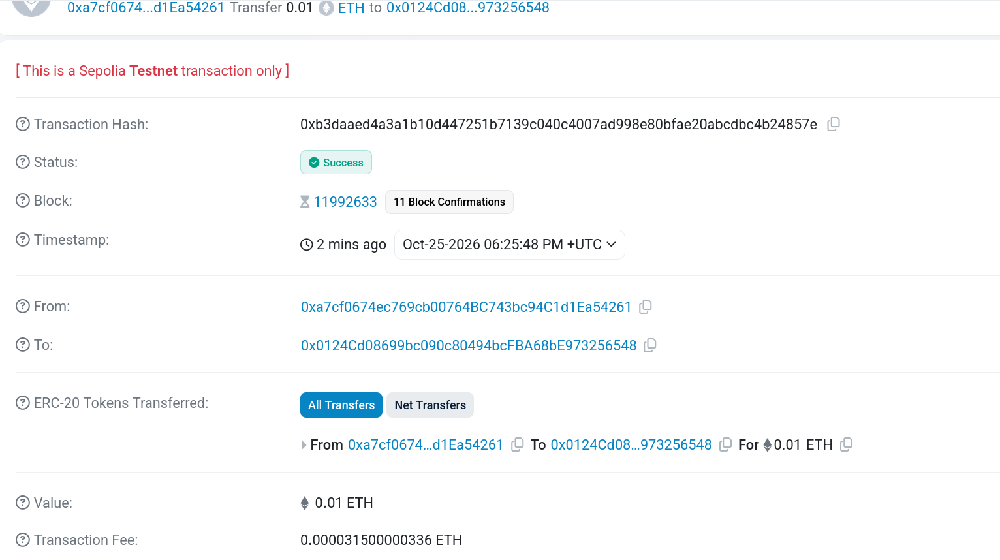

# Ejercicio 3

A continuacion se muestran la secuencia para la obtencion de ETH en la red sepolia usando el faucet de [GCP (Google Cloud)](https://cloud.google.com/application/web3/faucet/ethereum/sepolia).

1. Transaccion incompleta

2. Transaccion Completa

3. Balance en Metamask final

4. Transaccion a un compañero

5. Transaccion de compañero

